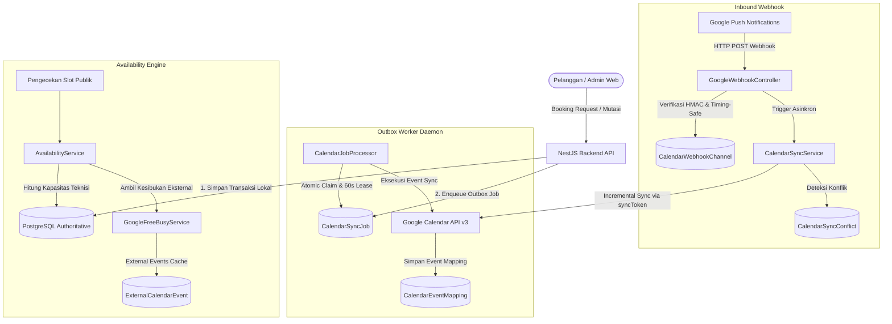

# Arsitektur Integrasi Google Calendar (CoolCare AC)

Dokumen ini mendokumentasikan arsitektur proyeksi jadwal kalender bersama (Shared Calendar Basic v1), alur sinkronisasi outbox, dan penanganan multi-teknisi.

---

## 1. Diagram Arsitektur Tingkat Tinggi



---

## 2. Invarian Kalender Bersama Multi-Teknisi (Basic v1)

Dalam model bisnis servis AC lapangan (Field Service) CoolCare:
1. **Satu Kalender Bisnis Terpusat**: Seluruh jadwal teknisi diproyeksikan ke dalam 1 Google Calendar bersama milik perusahaan (bukan 1 kalender per teknisi).
2. **PostgreSQL Sebagai Sumber Kebenaran Mutlak (Authoritative Source of Truth)**:
   - Status pemesanan, pembagian slot, penugasan teknisi, dan perhitungan waktu buffer ditentukan mutlak oleh PostgreSQL Booking Engine.
   - Keberadaan event pemesanan di Google Calendar tidak membatasi teknisi lain untuk menerima pemesanan pada jam yang sama (selama kuota teknisi aktif masih tersedia).
3. **Penyaringan Event Mandiri (`extendedProperties.private.source`)**:
   - Setiap event yang dibuat oleh sistem CoolCare ditandai dengan:
     ```json
     {
       "extendedProperties": {
         "private": {
           "source": "TampilKit-AC",
           "bookingId": "uuid-booking",
           "businessId": "uuid-business"
         }
       }
     }
     ```
   - Komponen `GoogleFreeBusyService` memfilter dan mengabaikan event bertanda `TampilKit-AC` agar tidak menimbulkan *double counting* atau pemblokiran mandiri terhadap teknisi lain.
4. **Jadwal Kesibukan Eksternal (`EXTERNAL_BUSY`)**:
   - Event yang dibuat manual oleh manajemen langsung di antarmuka Google Calendar (misal: "Libur Operasional", "Pemeliharaan Bengkel", "Meeting Bulanan") diklasifikasikan sebagai `EXTERNAL_BUSY`.
   - Event ini diperlakukan sebagai penutupan toko global yang memblokir semua teknisi pada rentang waktu tersebut.
