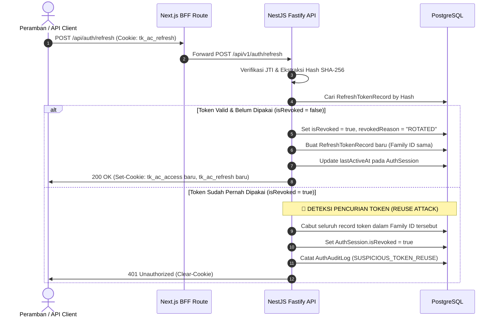

# Siklus Hidup JWT Token & Mekanisme Rotasi (Phase 02)

## 1. Karakteristik & Format Token

Sistem menggunakan pustaka `jose` (standar Web Cryptography) untuk menandatangani dan memverifikasi token JWT dengan algoritma HS256.

### A. Access Token
- **Format**: JWT (JSON Web Signature)
- **TTL**: 15 menit (`JWT_ACCESS_EXPIRATION_TIME=15m`)
- **Secret Key**: `JWT_ACCESS_SECRET` (terpisah dari refresh token)
- **Payload**:
  ```json
  {
    "sub": "user-uuid",
    "email": "owner@coolcare.id",
    "role": "OWNER",
    "sessionId": "session-uuid",
    "tokenVersion": 1,
    "jti": "random-unique-id",
    "iat": 1793174400,
    "exp": 1793175300
  }
  ```

### B. Refresh Token
- **Format**: Opaque cryptographically random hex token (64 hex characters / 256 bits of entropy) atau JWT terenkripsi dengan secret terpisah.
- **TTL**: 7 hari (`JWT_REFRESH_EXPIRATION_TIME=7d`)
- **Secret Key**: `JWT_REFRESH_SECRET`
- **Penyimpanan di DB**: Nilai plaintext token TIDAK PERNAH disimpan di database. Backend hanya menyimpan **SHA-256 hash** dari token di tabel `RefreshTokenRecord`.

---

## 2. Mekanisme Rotasi Atomik (Token Rotation)

Setiap pemanggilan endpoint `/api/v1/auth/refresh` menjalankan alur rotasi berikut di dalam PostgreSQL Prisma Transaction (`$transaction`):



---

## 3. Deteksi Penggunaan Kembali (*Reuse Detection*)

Bila penyerang berhasil mencuri sebuah refresh token yang sudah pernah digunakan oleh pengguna sah:
1. Penyerang mencoba memanggil `/refresh` dengan token lama tersebut.
2. Sistem mendeteksi bahwa token tersebut memiliki status `isRevoked: true` dengan alasan `ROTATED`.
3. Logika deteksi keamanan langsung terpicu:
   - Sesi (`AuthSession`) seketika dinyatakan invalid (`isRevoked: true`).
   - Seluruh refresh token yang bernaung di bawah `familyId` yang sama langsung dicabut.
   - Sesi pengguna sah pada perangkat tersebut terputus, memaksanya melakukan login ulang dan mengamankan akunnya.
   - Peristiwa dicatat di `AuthAuditLog` sebagai insiden keamanan.

---

## 4. Validasi Multi-Lapis pada Setiap Request

Setiap panggilan ke endpoint terproteksi (`JwtAuthGuard`) memverifikasi 3 lapis validasi:
1. **Validasi Kriptografi**: Tanda tangan token dicocokkan dengan `JWT_ACCESS_SECRET`. Token yang kedaluwarsa atau dimanipulasi akan langsung ditolak (HTTP 401).
2. **Validasi Token Version**: Memastikan `tokenVersion` di payload sama dengan `User.tokenVersion` di database. Jika pengguna melakukan "Logout dari semua perangkat" atau mengganti kata sandi, `tokenVersion` dinaikkan dan seluruh access token lama ditolak seketika.
3. **Validasi Keaktifan Sesi**: Memastikan `AuthSession` yang dirujuk oleh `sessionId` masih ada di database dan belum dicabut (`isRevoked: false`).
